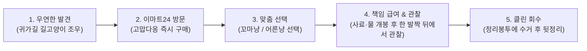

# [PRD] 이마트24 PL 책임형 길고양이 급여 키트 '고맙다옹' 발표용 웹페이지 제품 기획서

---

## 1. 프로젝트 개요 (Project Overview)

### 1.1 프로젝트 정의
- **프로젝트명**: 이마트24 단독 PL '고맙다옹' 상품 기획 발표용 인터랙티브 웹페이지
- **브랜드/유통사**: 이마트24 (자체 PB/PL 라인업: *I'm e*)
- **상품명**: **고맙다옹** (Gomabdaong)
- **상품 유형**: 책임형 길고양이 일회용 급여 키트 (사료 + 컵 물 + 회수용 정리봉투 + 슬리브 가이드)
- **웹페이지 목적**: 대학교 상품기획 공모전 / 사내 신상품 제안 발표(Pitching)를 위한 고품질 인터랙티브 프레젠테이션 웹페이지 구축
- **기술 제약**:
  - 데이터베이스(DB) 미사용 (서버리스/클라이언트 사이드 동작)
  - 순수 **바닐라 HTML5, CSS3, JavaScript (ES6+)** 단독 구현
  - 추후 삽입될 **9:16 세로형 숏폼(Shorts) 영상 플레이어 모듈** 사전 설계 및 지원

### 1.2 핵심 슬로건 및 포지셔닝 메시지
> **"기존 NB가 '무엇을 먹일까'에 집중했다면, 고맙다옹은 '어떻게 책임 있게 먹일까'에 집중합니다."**
- **서브 슬로건**:
  - *"한 끼의 마음까지 책임 있게"*
  - *"먹이를 파는 것이 아니라, 먹이는 방법을 팝니다"*
  - *"작은 한 끼가 만드는 더 따뜻한 공존"*

---

## 2. 기획 배경 및 시장 기회 (Background & Opportunity)

### 2.1 편의점 반려동물 시장의 폭발적 성장
- **이마트24 매출 데이터**: 최근 3개년 반려동물 용품 카테고리 매출 연평균 **40% 신장**.
- **주거 상권 집중도**: 전체 반려동물 관련 매출의 **75%가 1인 가구 및 주거 밀집 상권**에서 발생.
- **구매 패러다임 변화**: 사전 계획 구매뿐만 아니라, 귀가길·골목길에서 발생하는 즉각적이고 우발적인 '즉시 구매' 수요 급증.

### 2.2 길고양이 급여 시장의 미충족 니즈 (Unmet Needs)
| 구분 | 기존 시장 (NB 사료 / 캔) | 고맙다옹 (이마트24 PL) |
| :--- | :--- | :--- |
| **구매 형태** | 1~3kg 대용량 백 또는 단품 캔 | 1회 급여 최적화 올인원 키트 |
| **급여 준비물** | 별도 식기, 깨끗한 물, 티슈 별도 필요 | 볼 2종(사료+물) 일체형 제공 |
| **현장 관리** | 급여 후 방치로 주민 갈등/민원 발생 | 회수용 친환경 봉투 및 3대 수칙 슬리브 제공 |
| **지향 가치** | 단순한 영양·기호성 중심 | **클린 피딩(Clean Feeding)과 상생 문화** |

---

## 3. 타깃 고객 페르소나 및 사용자 여정 (Persona & Journey)

### 3.1 대표 페르소나: 김서연 (24세, 대학생)
- **주거/생활 패턴**: 학교 근처 원룸촌 1인 가구 거주, 통학 및 아르바이트 후 귀가 시 편의점 일 1~2회 방문.
- **반려동물 현황**: 직접 키우진 않지만 고양이를 매우 좋아하며 SNS 펫 콘텐츠를 즐겨봄.
- **행동 특성**: 골목길 길고양이를 마주치면 마음이 쓰이지만, 평소 무거운 사료를 챙겨 다니지 않음.
- **핵심 고민 (Pain Points)**:
  > *"한 번 챙겨주고 싶은데 사료 한 봉지를 사기엔 양도 가격도 부담스럽고, 깨끗한 물이랑 그릇도 없네."*  
  > *"고양이에게 밥은 주고 싶지만, 그릇을 남겨둬서 골목이 지저분해지거나 주민들에게 피해를 줄까 봐 걱정돼."*
- **한 줄 정의**: *"고양이를 좋아하지만 사료를 상시 휴대하지 않는, 책임감 있게 동네 고양이를 챙기고 싶은 20대 대학생."*

### 3.2 5단계 사용자 경험 여정 (Customer Journey)


---

## 4. 상품 상세 스펙 및 패키지 구조 (Product Specification)

### 4.1 제품 라인업 및 가격 구성
| 상품명 | 타깃 연령 | 용량 및 구성 | 권장 소비자가 | 패키지 메인 컬러 |
| :--- | :--- | :--- | :--- | :--- |
| **고맙다옹 꼬마냥 밥물세트** | 1세 미만 자묘 (Kitten) | 건식 사료 80g + 음용수(컵 물) + 회수봉투 | **2,500원** | 웜 오렌지 & 소프트 크림 |
| **고맙다옹 어른냥 밥물세트** | 1세 이상 성묘 (Adult) | 건식 사료 80g + 음용수(컵 물) + 회수봉투 | **2,800원** | 내추럴 세이지 그린 & 어스 베이지 |

### 4.2 패키지 구조 (All-in-One Dual Sphere Bowl)
1. **상·하 분리형 반구형 용기 (2단 일체형)**:
   - 상단 볼: 안심 씰링된 고양이 건식 사료 (80g)
   - 하단 볼: 밀봉된 깨끗한 급여용 컵 물
   - 뚜껑을 개봉하면 그대로 2개의 식기(밥그릇, 물그릇)로 변환되어 별도 용기 불필요.
2. **동봉 정리봉투**:
   - 용기 내부 콤팩트 접이식 친환경 비닐봉투 수납. 급여 종료 후 잔여물 및 용기를 즉시 담아 회수 가능.
3. **가로형 종이 슬리브 (라벨 & 가이드)**:
   - 전면: 이마트24 *I'm e* 로고, 고양이 캐릭터 일러스트 및 실사 비주얼, 상품명.
   - 후면: **'고맙다옹 급여 시 3대 주의사항'** 인포그래픽 수록.

### 4.3 슬리브 뒷면 3대 급여 가이드 (클린 피딩 수칙)
1. **주거공간 앞에서는 급여하지 않기**: 현관·대문·공동현관 등 주민 생활·통행 공간을 피한 안전한 장소 선택.
2. **급여 후 한 발짝 떨어져서 지켜보기**: 고양이가 경계하거나 불안해하지 않도록 안전거리를 두고 편안한 식사 관찰.
3. **남은 사료와 용기는 반드시 치우기**: 방치된 사료는 부패 및 해충 유발 원인이 되므로, 동봉된 봉투에 즉시 회수하여 폐기.

---

## 5. 웹페이지 기획 및 화면 구성 (Information Architecture)

웹페이지는 **'발표용 피칭 덱(Pitch Deck) 모드'**와 **'인터랙티브 스크롤 스토리텔링 모드'**를 모두 만족하도록 설계합니다.

```
[ 상단 고정 헤더 (Global Navigation Bar) ]
- Emart24 x I'm e 브랜딩 로고
- 섹션 바로가기 네비게이션
- 프레젠테이션 모드 토글 (슬라이드 전환 / 전체화면 / 발표 대본 모달)

[ 섹션 1: Hero - 키 비주얼 및 프로젝트 선언 ]
- 타이틀: "한 끼의 마음까지 책임 있게, 이마트24 PL 고맙다옹"
- 듀얼 캡슐 패키지 3D 틸트 목업 및 편의점 매대 비주얼
- 핵심 통계 요약 (40% 매출 신장, 75% 주거 상권, 올인원 100%)

[ 섹션 2: Market Problem & Opportunity - 시장의 결핍과 기회 ]
- 길고양이 사료 시장의 딜레마 (대용량/물그릇 부재/민원 갈등)
- 편의점 반려동물 카테고리 급성장 데이터 인포그래픽 차트
- 포지셔닝 맵: NB 사료(영양 위주) vs 고맙다옹(책임 급여 위주)

[ 섹션 3: Persona & Customer Journey - 24세 김서연의 하루 ]
- 페르소나 카드 (`79dbf808-f2d6-49b6-8975-ff4f90122758.png` 기반 UI)
- 5단계 인터랙티브 사용 여정 스텝퍼 (단계별 탭/클릭 시 애니메이션)

[ 섹션 4: Product Detail & Teaser - '고맙다옹' 제품 분해 쇼케이스 ]
- 꼬마냥(2,500원) vs 어른냥(2,800원) 탭 전환 및 360° 패키지 뷰어
- 언패킹 인터랙션: [사료 볼] + [물 볼] + [정리봉투] + [슬리브] 분해 레이어 애니메이션 (`image (1).png` 활용)
- 패키지 앞면/뒷면 전환 뷰 (`image (2).png` 활용)

[ 섹션 5: Clean Feeding Guide - 책임 있는 3대 급여 수칙 ]
- 슬리브 후면 인터랙티브 카드 (주거지 앞 금지 / 한 발짝 거리두기 / 잔여물 회수)
- 올바른 펫티켓 가이드 및 상생 메시지 강조

[ 섹션 6: Shorts Showcase - 9:16 세로형 숏폼 영상 존 ]
- 세로형(9:16) 스마트폰 프레임 목업 플레이어
- 영상 컨트롤러 (재생/정지, 음소거, 진행바, 자막 오버레이, 하트/공유 반응형 버튼)
- 비디오 파일 부재 시 고품질 CSS/Canvas 키네틱 타이포그래피 애니메이션 자동 동작
- 실제 `shorts.mp4` 비디오 파일 위치 시 즉시 영상 로드 및 원활한 재생 보장

[ 섹션 7: Competitive Edge & Risk Management - 차별화 & 리스크 대응 ]
- 4대 핵심 차별화 포인트 (올인원 / 즉시성 / 클린피딩 / 브랜드가치)
- 2대 리스크 관리 방안 (미섭취 시 회수 정책 / 급여 장소 갈등 예방 대책)

[ 섹션 8: Retail Shelf & Pitch Summary - 매대 진열 및 기대효과 ]
- 이마트24 실제 매대 진열 시뮬레이션 (`image_1024.png` 인터랙티브 핫스팟)
- ESG 상생 효과 및 이마트24 브랜드 충성도 향상 지표
- 발표 마무리 맺음말 & Q&A 섹션

[ 푸터 (Footer) ]
- 기획자 정보, 발표일 (2026.10), 이마트24 PL 상품기획안 고지
```

---

## 6. 9:16 세로형 쇼츠(Shorts) 영상 플레이어 기술 규격

### 6.1 플레이어 UI 및 컴포넌트 구조
1. **외형 프레임**: 최신 플래그십 스마트폰(아이폰/갤럭시 스타일) 베젤 및 노치/다이내믹 아일랜드가 적용된 세로형 9:16 뷰포트 (`aspect-ratio: 9 / 16`).
2. **반응형 숏폼 오버레이 UI**:
   - 우측 인터랙션 바: 하트(좋아요 카운트 토글), 댓글 아이콘, 공유하기, 음소거 토글 버튼.
   - 하단 메타 정보: `@emart24_official`, `#고맙다옹 #이마트24PL #길고양이한끼 #클린피딩` 해시태그, 오디오 음원 트랙 티커.
   - 하단 프로그레스 바: 실시간 재생 바 및 드래그 탐색 기능.

### 6.2 미디어 폴백 및 무중단 지원 (Fallback & Auto-Detection)
- **비디오 파일 경로**: `./shorts.mp4` 또는 `./assets/shorts.mp4`
- **폴백 메커니즘**:
  - 페이지 로드 시 해당 경로에 비디오 파일이 없거나 에러(`video.onerror`)가 발생할 경우, **디자인 목업 비디오 프리뷰 상태**로 자동 전환.
  - 내부에 스토리텔링 키네틱 텍스트, 고양이 일러스트, 틱톡/릴스 스타일의 세로 모션 애니메이션이 자동으로 루프 재생되어 발표 시 완벽한 시각적 효과 유지.
  - 사용자가 비디오 파일을 폴더에 추가하면 코드 수정 없이 즉시 실제 영상이 렌더링되도록 동적 감지 로직 적용.

---

## 7. 발표용 특화 기능 (Presentation Mode Requirements)

1. **발표자 모드 (Pitch / Presentation Controls)**:
   - 단축키 지원: `Space` / `→` (다음 섹션 스크롤), `←` (이전 섹션), `F` (전체화면 토글).
   - 우측 상단 슬라이드 인덱스 인디케이터 (예: `03 / 08`).
   - 하단 스크롤 진행률 프로그레스 바.
2. **발표자 스크립트 모달 (Speaker Notes)**:
   - 발표자가 버튼을 누르거나 `N` 키를 누르면 각 슬라이드/섹션에 매핑된 구두 발표 스크립트가 반투명 오버레이로 표시 (`image (5).png` 발표용 문장 등 포함).
3. **에셋 핫스팟 및 모달 팝업**:
   - 진열대 사진(`image_1024.png`)이나 페르소나 보드(`79dbf808-f2d6-49b6-8975-ff4f90122758.png`) 클릭 시 고해상도 라이트박스 뷰어 제공.

---

## 8. 기술 스택 및 아키텍처 (Technical Architecture)

```
emart_24/
│
├── PRD.md                                   # 본 기획 문서
├── index.html                               # 시맨틱 마크업 및 단일 페이지 구조
├── css/
│   ├── reset.css                            # 브라우저 초기화
│   ├── variables.css                        # 이마트24 브랜드 컬러, 타이포그래피, 디자인 토큰
│   └── style.css                            # 레이아웃, 컴포넌트, 9:16 플레이어, 애니메이션
├── js/
│   ├── main.js                              # 초기화, 라우팅, 스크롤 인터랙션
│   ├── presentation.js                      # 발표 모드(슬라이드 제어, 키보드 이벤트, 발표 스크립트)
│   ├── shorts-player.js                     # 9:16 쇼츠 플레이어 컨트롤 및 폴백 시뮬레이션
│   └── components.js                        # 패키지 분해 뷰어, 핫스팟, 페르소나 인터랙션
└── (Existing Assets)
    ├── image_1024.png                       # 매대 진열 실사 목업
    ├── 79dbf808-f2d6-49b6-8975-ff4f90122758.png # 페르소나 및 5단계 사용 여정
    ├── image (1).png                        # 제품 구성(사료볼+물볼+정리봉투) 분해 샷
    ├── image (2).png                        # 패키지 앞면/뒷면 및 3대 주의사항
    ├── image (3).png ~ image (7).png        # 시장 기회, 차별화 포인트, 리스크 대응 슬라이드
    ├── KakaoTalk_20261015_142325083.mp4     # 실제 9:16 세로형 쇼츠 비디오 파일 (연동 완료)
    └── shorts.mp4                           # 비디오 별칭 파일 (동일 영상)
```

### 8.1 디자인 시스템 & 컬러 팔레트
- **Primary Brand Color**: 이마트24 옐로우 (`#FFB800` / `#FFAA00`)
- **Secondary Brand Color**: 이마트24 딥 그레이/차콜 (`#231F20` / `#1E2022`)
- **Kitten Accent**: 웜 오렌지 & 크림 (`#FF8A3D`, `#FFF5EB`)
- **Adult Accent**: 세이지 그린 & 베이지 (`#5A8D6E`, `#F0F5F1`)
- **Neutral Background**: 라이트 모드 기본 (`#F8F9FA`, 카드 `#FFFFFF`), 텍스트 (`#191F28`, `#4E5968`)
- **Typography**: Google Fonts - 'Pretendard' 또는 'Noto Sans KR' 웹폰트 적용.

---

## 9. 산출물 및 검증 기준 (Acceptance Criteria)

1. **기획 부합도**:
   - `gomabdaong_project_summary.txt` 및 폴더 내 8종 이미지의 모든 핵심 데이터(김서연 페르소나, 80g 사료+물 분리형 캡슐, 3대 급여 수칙, 4대 차별화, 2대 리스크, 40% 신장률 등)가 빠짐없이 반영되었는가?
2. **쇼츠 비디오 모듈**:
   - 9:16 세로형 플레이어가 정상 렌더링되며, 실제 비디오 파일이 없을 때도 미려한 시뮬레이션/모션이 노출되는가?
   - 추후 `shorts.mp4` 투입 시 정상적으로 비디오가 자동 재생/컨트롤되는가?
3. **발표 편의성 (Pitch-Ready)**:
   - 프로젝터/대형 스크린 환경에서 가독성이 뛰어나며, 키보드 및 네비게이션으로 자연스러운 슬라이드 전환이 가능한가?
   - 발표자 스크립트 확인 기능이 내장되어 있는가?
4. **코드 품질**:
   - 외부 라이브러리/프레임워크(React, Vue, Tailwind 등) 의존 없이 순수 Vanilla HTML/CSS/JS로 가볍고 빠르게 구동되는가?
   - 반응형 디자인으로 모바일/태블릿/데스크톱 모두에서 깨짐 없이 표시되는가?

---

*본 문서는 이마트24 PL '고맙다옹' 발표용 웹페이지 제작을 위한 최종 제품 요구사항 정의서(PRD)입니다.*
